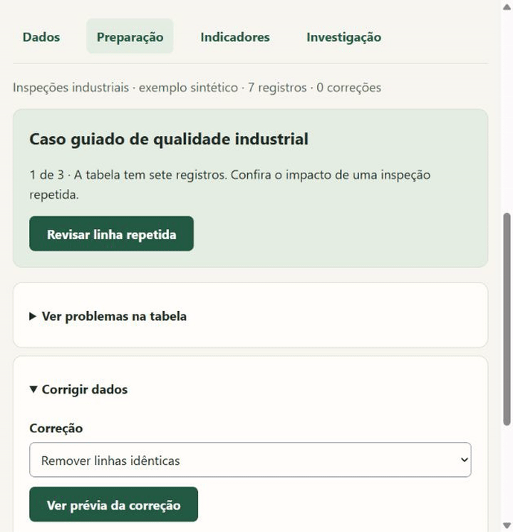
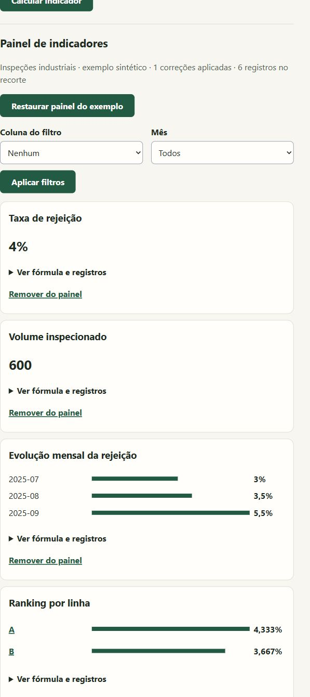
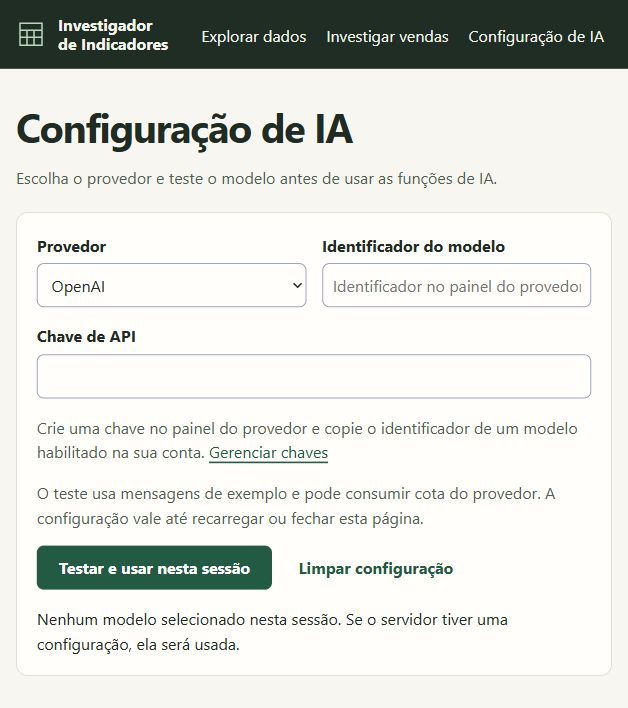
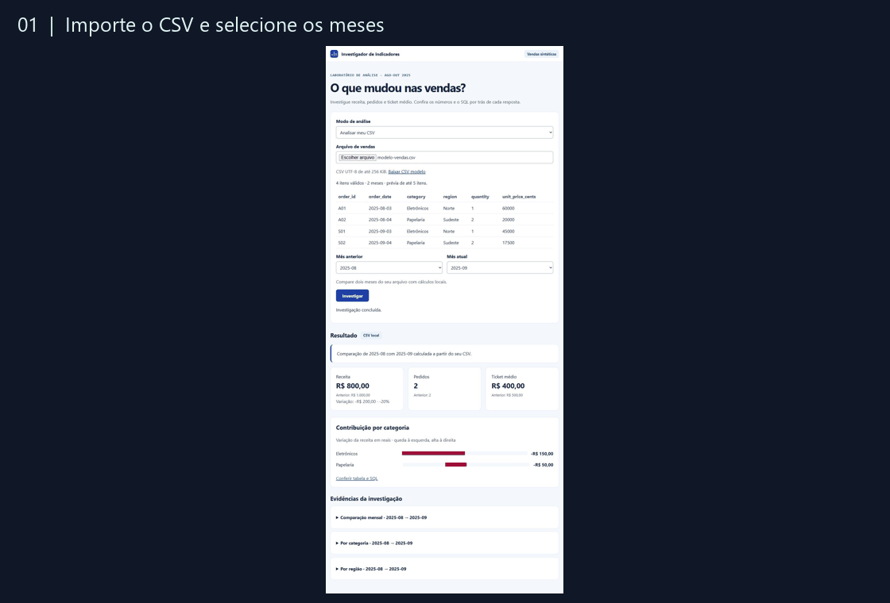
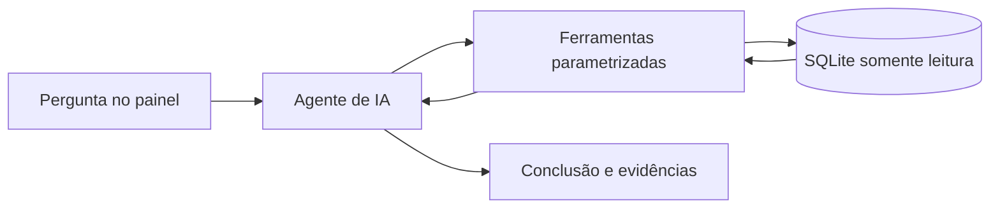

# Nexo Dados

**Análise de planilhas com indicadores auditáveis e assistência de IA.**

Importe CSV ou Excel, revise problemas de qualidade, monte indicadores e investigue mudanças com acesso às fórmulas e aos dados do recorte.

[Rodar localmente](#rodar-a-demonstração) · [Caso de qualidade industrial](#caso-de-portfólio--qualidade-industrial) · [Como a IA participa](#como-a-ia-participa) · [Testes](#casos-reproduzíveis)



**O caso em 30 segundos.** Depois de revisar e remover um registro duplicado, o painel calcula uma taxa geral de rejeição de **4% em 600 itens inspecionados**. A investigação da linha A mostra a taxa subir de **3% para 8%** entre agosto e setembro. O CSV exportado registra os totais e a fórmula que sustentam a comparação. O exemplo usa dados sintéticos e roda sem chave de API.

## Caso de portfólio · qualidade industrial



1. Clique em **Experimentar com dados de exemplo** para abrir sete registros sintéticos de inspeção.
2. Em **Preparação**, abra **Corrigir dados** e selecione **Remover linhas idênticas**. Revise a prévia e aplique a remoção de um registro.
3. Em **Indicadores**, clique em **Adicionar indicadores do exemplo**. A tabela tratada tem 600 itens inspecionados e taxa geral de 4%. Veja a evolução mensal e o ranking por linha.
4. Clique na linha A do ranking ou em **Investigar linha A**. De agosto para setembro de 2025, a taxa passou de 3% para 8%, um aumento de 5 pontos percentuais. Use **Exportar recorte e evidências** para salvar os registros, a fórmula e os totais em CSV.

O painel também aceita indicadores calculados manualmente ou sugeridos pela IA. Use **Adicionar indicador ao painel** e recalcule o conjunto com um filtro de valor exato e, quando houver uma coluna Data, um mês. Os indicadores fixados duram enquanto a tabela estiver aberta.

## Configuração de IA



Abra **Configuração de IA** no menu do painel. Para OpenAI, Claude (Anthropic), Gemini (Google), Groq ou DeepSeek, use o link de chaves do provedor e informe o identificador do modelo habilitado na conta. Para Ollama local, instale e inicie o serviço, baixe um modelo e informe o nome exibido por `ollama list`. O painel usa a porta local 11434.

Clique em **Testar e ativar modelo** para verificar a conexão, a chamada de ferramenta e a resposta JSON. Modelos podem ter níveis diferentes de suporte a esses recursos. A chave digitada fica em memória na página e é descartada ao recarregar ou fechar. A configuração por variáveis de ambiente serve como alternativa.

### Avaliação do agente

Execute `python evaluate_agent.py` com `OPENAI_API_KEY` e `OPENAI_MODEL`. O relatório JSON mostra o plano escolhido, os resultados locais e se o caso passou. Os casos cobrem taxa por linha, soma, pergunta ambígua, coluna ausente e denominador zero. A execução ao vivo está pendente de credenciais. A demonstração acima usa dados sintéticos e cálculos locais.

## Rodar a demonstração

Use o botão **Modo escuro** ou **Modo claro** no menu para alternar com um clique. A escolha fica guardada no navegador.

Requer Python 3.10 ou superior. Clone o repositório e inicie o servidor:

```sh
git clone https://github.com/alex10presam-lang/nexo-dados.git
cd nexo-dados
python app.py
```

Abra [o painel local](http://127.0.0.1:8765). O servidor gera uma base temporária no início. A demonstração usa respostas gravadas identificadas na interface e executa as consultas na base local. Nenhuma chave ou instalação de pacotes é necessária.

## Explorar qualquer tabela

### Reaplicar uma análise em outro período

1. Importe [inspeções de agosto](examples/inspecoes-agosto.csv) em **Dados**.
2. Abra **Combinar com outro arquivo**, selecione [inspeções de setembro](examples/inspecoes-setembro.csv), confira o mapeamento e combine. A tabela identifica o arquivo de origem de cada linha.
3. Em **Reaplicar receita de análise**, abra a [receita de qualidade](examples/receita-qualidade.json) e aplique. Ela restaura as correções, os dois indicadores, os gráficos e a meta de 3%. **Salvar receita de análise** gera um JSON com a configuração atual. O JSON contém as regras, fórmulas, metas e filtros.
4. Em **Indicadores**, clique numa barra ou ponto para filtrar o painel. O seletor **Filtrar painel por grupo** oferece a mesma ação pelo teclado. Cada indicador agrupado permite trocar entre barras e linha e exportar o gráfico em SVG.
5. Em **Investigação**, compare agosto e setembro. A linha A vai de 3% a 8%. Com a IA configurada, use **Propor plano de análise**, revise ou edite o cálculo e só então execute. A opção de usar o recorte atual aplica os filtros da última atualização do painel.

Em **Explorar dados**, use **Importar tabela** para abrir CSV UTF-8 ou Excel `.xlsx` de até 1 MiB. Escolha a linha com cabeçalhos únicos e, no Excel, a aba. Para habilitar Excel, execute `python -m pip install -r requirements.txt`.

Abra **Diagnóstico da tabela** para conferir vazios, números e datas reconhecidos, variações de categorias e linhas idênticas. Em **Corrigir dados**, escolha a correção e confira exemplos de antes e depois. As correções aprovadas são reaplicadas à cópia da tabela durante a análise. O arquivo original é preservado.

Use **Sugestões de indicadores com IA** para receber até três propostas com tema, fórmula e colunas a confirmar. **Calcular este indicador** executa o cálculo localmente sobre os dados tratados. A API recebe o perfil das colunas e contagens do diagnóstico.

Em **Cálculo manual**, use **Calcular indicador** para trabalhar localmente. Em uma tabela de inspeções, selecione **Taxa (%)**, indique as colunas de rejeitados e inspecionados e agrupe por linha. A taxa divide a soma dos rejeitados pela soma dos inspecionados e usa as linhas com os dois valores preenchidos.

Com `OPENAI_API_KEY` e `OPENAI_MODEL` configurados, **Perguntar à IA** envia a pergunta e o perfil das colunas à API. O modelo escolhe uma operação e o programa calcula o resultado localmente. A tabela mostra a operação, o agrupamento e o filtro escolhido. Para análises maiores, o painel exibe até 100 grupos.

## Analisar seu CSV de vendas



Na base sintética, a receita caiu de R$ 1.000 para R$ 800. Eletrônicos respondeu por R$ 150 da diferença. O painel permite conferir a contribuição por categoria e o SQL executado. Veja também as capturas em tamanho original do [fluxo de importação](docs/importacao-csv.jpg) e do [painel de vendas](docs/painel.jpg).

Selecione **Analisar meu CSV** e baixe o [arquivo modelo](examples/modelo-vendas.csv). A primeira linha define as colunas. Use UTF-8, vírgula ou ponto e vírgula, datas AAAA-MM-DD e preço unitário em centavos inteiros. Cada linha representa um item do pedido. O limite é de 256 KiB.

O painel indica o primeiro erro encontrado com a linha e, quando aplicável, a coluna. Após a validação, você pode conferir até cinco itens e escolher dois meses disponíveis. O servidor local calcula os indicadores e exibe o gráfico, as tabelas e o SQL. O arquivo é processado localmente, e o SQLite temporário da comparação é removido após a consulta.

## Como a IA participa

No modo **Agente de IA ao vivo**, a pergunta é enviada a um modelo OpenAI com a descrição de três ferramentas. O modelo escolhe a ferramenta e informa os meses. O software valida os argumentos, executa a consulta parametrizada em SQLite somente leitura e envia os resultados agregados ao modelo. O agente pode fazer até cinco consultas antes de apresentar uma conclusão.



Configure `OPENAI_API_KEY` e `OPENAI_MODEL` no ambiente antes de iniciar o servidor. Use um modelo disponível na sua conta que aceite ferramentas na API Chat Completions. O modo ao vivo envia a pergunta e os resultados agregados à API e pode gerar custos conforme a sua conta. Consulte a [referência da API](https://developers.openai.com/api/reference/resources/chat).

Quando a pergunta não identifica um período, o agente pode pedir os meses antes de consultar a base. Inclua os meses na pergunta e envie novamente. Quando houver um detalhamento, o painel mostra um gráfico com as contribuições em reais e um link para abrir a tabela e o SQL correspondentes.

O SQL calcula os indicadores. O texto gerado deve ser conferido com o painel de evidências. O detalhamento mostra a contribuição matemática de cada grupo. Investigar uma causa comercial exigiria dados adicionais.

## Estrutura do projeto

| Componente | Responsabilidade |
|---|---|
| [`app.py`](app.py) e [`web/`](web/) | Servidor HTTP local e interface em HTML, CSS e JavaScript |
| [`tabular.py`](tabular.py) e [`portfolio.py`](portfolio.py) | Importação, perfil de colunas, correções, indicadores e comparação |
| [`investigator.py`](investigator.py) e [`model.py`](model.py) | Ferramentas SQL, agente e adaptadores de modelos |
| [`examples/`](examples/) e [`tests/`](tests/) | Dados sintéticos, receita de exemplo e testes automatizados |

## Casos reproduzíveis

| Cenário | Evidência esperada |
|---|---|
| Setembro contra agosto | R$ 1.000 → R$ 800. Eletrônicos responde por R$ 150 da queda. |
| Outubro contra setembro | 8 → 10 pedidos. Ticket médio de R$ 100 nos dois meses. |
| Novembro contra outubro | Novembro sem registros. Comparação indisponível. |

```powershell
python -m unittest discover -s tests -v
```

Os testes cobrem a base, as métricas, o fluxo do agente com um modelo simulado e a demonstração pelo servidor local. A base contém vendas sintéticas com dois itens por pedido. A receita é bruta e os pedidos são contados por ID distinto.
